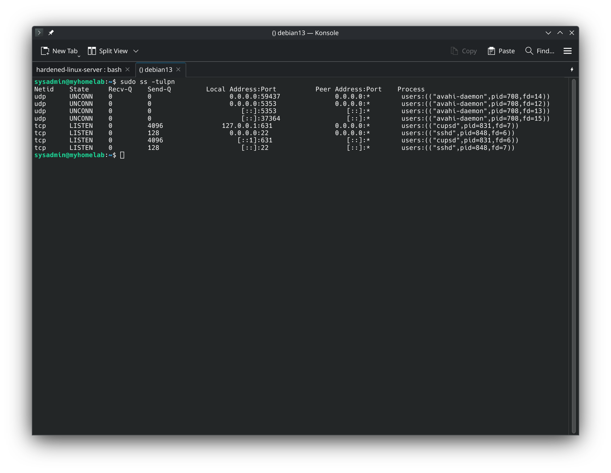
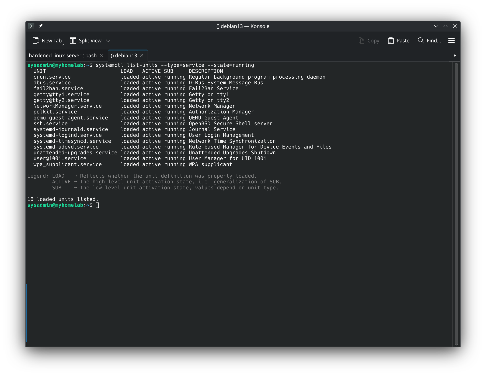

# hardened-linux-server

## VM specs :

	Os: Debian 13,
        cpu: 2 vCPU,
	ram: 2 GB RAM,
        storage: 28 GB qcow2,
	network: libvirt NAT, static IP

## Screeshots folder: screenshots

## Step 7: Automatic updates and service cleanup

**Automatic patching:** `unattended-upgrades` is enabled and applies Debian security updates on its own. A dry run (`unattended-upgrade --dry-run --debug`) confirmed the allowed origins include `Debian-Security` for trixie and finished with `upgrade result: True`.

**Attack surface:** I compared listening ports and running services before and after cleanup. Before, `avahi-daemon` (mDNS) and `cupsd` (printing) were listening. After disabling them, only `sshd` on port 22 remains.

### Services I removed

| Service | What it does | Why it went |
|---|---|---|
| avahi-daemon | Local network discovery (mDNS) | Not needed on a server, opens UDP ports |
| cups, cups-browsed | Printing | No printers, opened port 631 |
| ModemManager | Mobile modem management | No modem in a VM |
| rtkit-daemon | Realtime scheduling for desktop audio | Desktop component |
| fwupd | Firmware updates | The hypervisor handles firmware |
| udisks2 | Desktop disk mounting | Not needed headless |
| upower | Laptop power management | Not needed in a VM |
| packagekit | Desktop software updater | `unattended-upgrades` already handles updates |

### Services that remain (and why)

| Service | What it does | Why it stays |
|---|---|---|
| ssh | Remote access | The only way I manage the server |
| fail2ban | Bans IPs after repeated failed logins | Intrusion prevention (Step 6) |
| unattended-upgrades | Installs security updates automatically | Keeps the server patched |
| NetworkManager | Network configuration | Provides the VM's network connection |
| wpa_supplicant | Wi-Fi authentication helper | Pulled in by NetworkManager, harmless in a VM |
| dbus, polkit | System message bus and authorization | Core dependencies of other services |
| systemd-journald | Logging | fail2ban reads SSH logs from the journal |
| systemd-logind | Tracks user sessions | Required for logins |
| systemd-timesyncd | Time synchronization | Accurate time matters for logs and bans |
| systemd-udevd | Device management | Core system function |
| qemu-guest-agent | Host-to-VM communication | Lets libvirt see VM info and shut it down cleanly |
| cron | Scheduled jobs | Used by system maintenance tasks |
| getty@tty1, getty@tty2 | Console login prompts | Emergency access through the virt-manager console |
| user@1001 | Session manager for `sysadmin` | Runs while I'm logged in |

## Step 8: Audit and prove the result

Stage				Hardening index

Fresh install (Step 2)		62
After Steps 3-7			67
After 3 Lynis fixes		68
