# Hardened Linux Server

I built a Debian 13 server VM and locked it down the way a sysadmin would secure a new machine: SSH key-only login, a default-deny firewall, intrusion prevention, automatic security patching, and a measured security audit. Every step is documented here with screenshots, configs, and the problems I hit along the way.

**Result:** Lynis hardening index went from **62** on a fresh install to **68** after hardening, with only SSH exposed to the network.

| Password login denied | fail2ban banned an attacker | Only port 22 open |
|---|---|---|
| 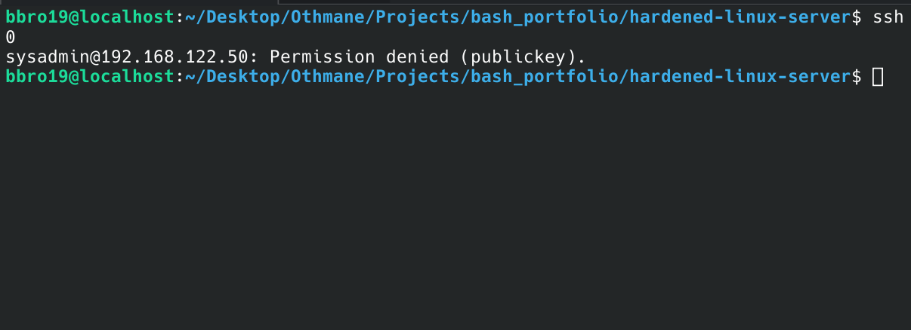 | 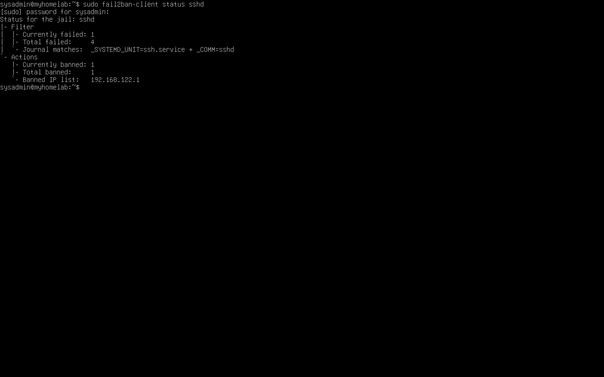 | 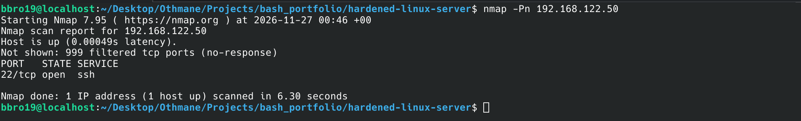 |

## What this project proves

- SSH key authentication with a passphrase-protected ed25519 key
- A hardened `sshd` configuration (no root login, no passwords, restricted users)
- A default-deny UFW firewall, verified from the outside with nmap
- fail2ban banning repeated failed logins, tested and unbanned
- Automatic security updates and a reduced attack surface
- Before/after measurement with Lynis, plus documented fixes

## Architecture

| Item | Value |
|---|---|
| Hypervisor | KVM/QEMU, managed with virt-manager and `virsh` |
| Guest OS | Debian 13 (trixie), headless |
| Resources | 2 vCPU, 2 GB RAM, 28 GB qcow2 disk |
| Disk storage | qcow2 file on a separate ext4 partition of the host |
| Network | libvirt NAT (`default`), static address via DHCP reservation |
| Access | Host-only over SSH, `ssh debian13` through `~/.ssh/config` |
| Users | `sysadmin` (sudo, the only SSH-allowed user); install user kept for console use |

A snapshot was taken after every step (`01-clean-install` through `08-audit`) so I could roll back if I locked myself out.

## Repo structure

```
README.md
configs/        sshd drop-in, fail2ban jail, UFW rules, running services
screenshots/    evidence for every step, named by step number
notes/          troubleshooting log and Lynis findings
```

Each step was done on its own branch (`step/01-lab-setup` to `step/09-finalize`) and merged into `main`.

## What I did

### Step 1: Lab setup
Created the VM from the Debian netinst ISO in virt-manager, installed the SSH server, and confirmed I could reach it from the host terminal. The disk lives on its own partition so the VM can never touch the host's operating systems.

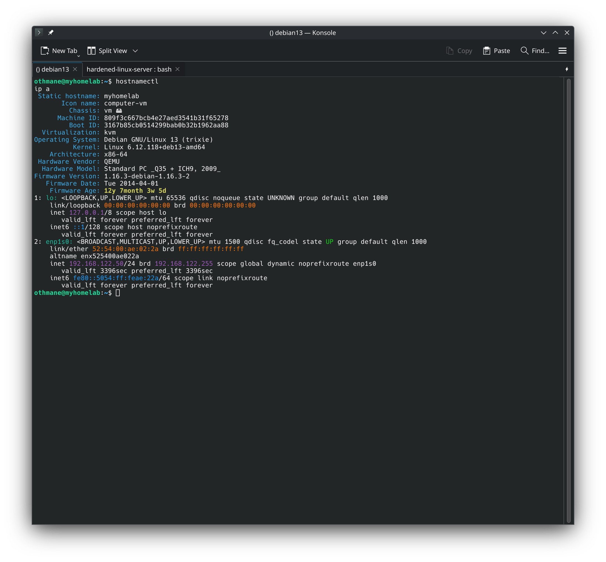

### Step 2: Baseline and sudo user
Updated the system and created a dedicated `sysadmin` account with sudo rights. I do not use root for daily work: a named account gives accountability in the logs, and a disabled root login removes one of the most attacked targets. I also ran **Lynis** before changing anything to record an honest baseline: **62**.

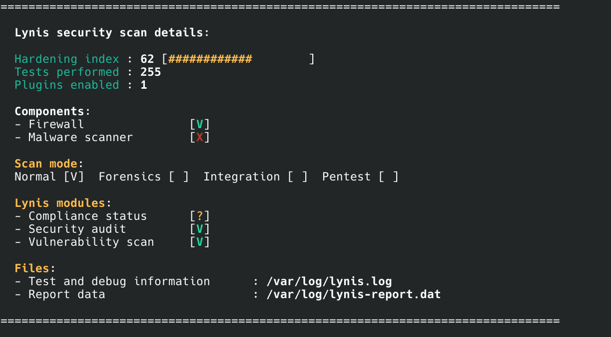

### Step 3: SSH key authentication
Generated a dedicated ed25519 key for this lab (separate from my personal key) with a passphrase, copied the public key to `sysadmin` with `ssh-copy-id`, and added a host alias in `~/.ssh/config` with `IdentitiesOnly yes`. Login now asks for the key passphrase instead of the account password. The private key is never committed (`.gitignore` blocks key files).

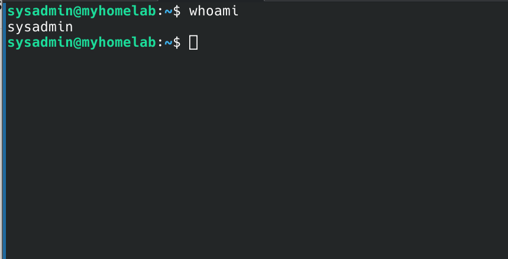

### Step 4: Hardened SSH daemon
Added a drop-in file, `configs/01-hardening.conf`. The `01` prefix matters because sshd uses the first value it finds, so this file must load before any other file that could re-enable passwords.

```
PermitRootLogin no
PasswordAuthentication no
PubkeyAuthentication yes
MaxAuthTries 3
LoginGraceTime 30
AllowUsers sysadmin
```

I validated the syntax with `sshd -t`, checked the effective values with `sshd -T`, and kept my existing session open while testing from a second terminal. Then I proved the lockdown from the outside: a password-only login and a root login both fail.


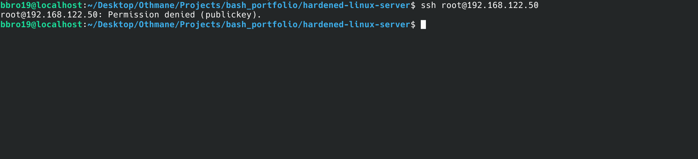

### Step 5: Firewall with UFW
Set UFW to deny all incoming traffic and allow outgoing, allowed SSH **before** enabling the firewall to avoid a lockout, then replaced the plain SSH rule with `ufw limit 22/tcp` to rate-limit brute force attempts. From the host, `nmap -Pn` shows only port 22 open. I also temporarily installed nginx and opened and closed port 80 to confirm the rules really control access, then removed it.

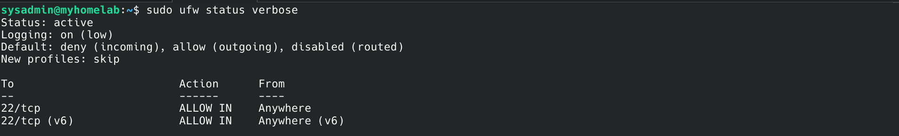


Rules are saved in `configs/ufw-status.txt`.

### Step 6: Intrusion prevention with fail2ban
Installed fail2ban and enabled the `sshd` jail (`configs/jail.local`) with 3 retries, a 10 minute window, and a 1 hour ban. Debian 13 has no `/var/log/auth.log` by default, so the jail uses `backend = systemd` to read the journal. To test it, I failed logins from the host until fail2ban banned the host's IP, confirmed the ban from the VM console, then unbanned it.


### Step 7: Automatic updates and service cleanup
`unattended-upgrades` is enabled and applies Debian security updates by itself. A dry run confirmed the allowed origins include `Debian-Security` for trixie and finished with `upgrade result: True`.

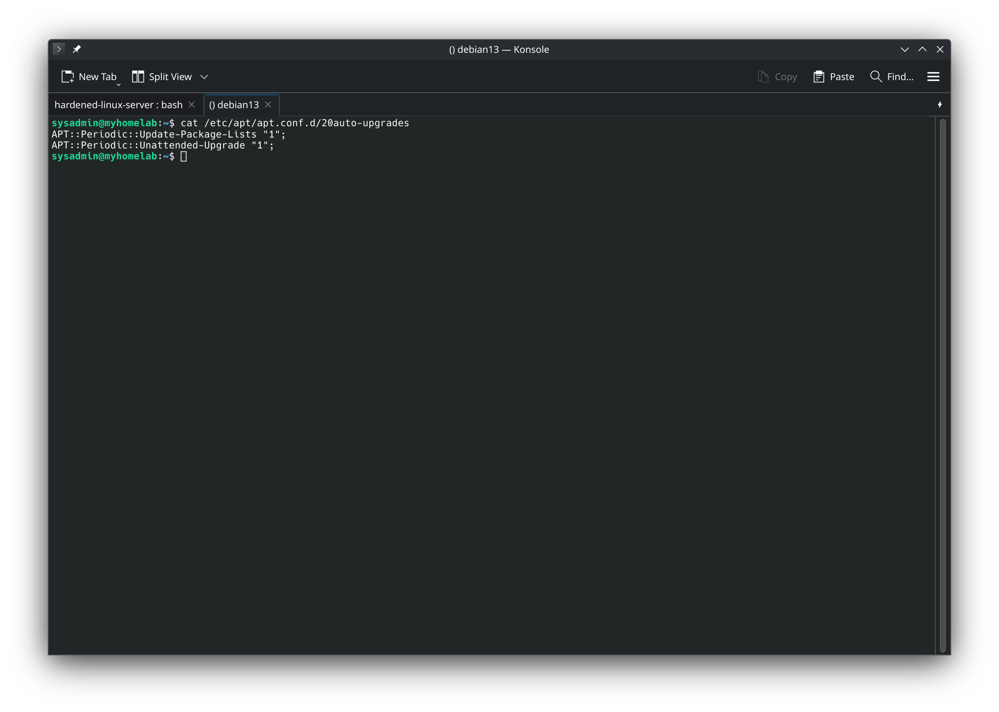

**Attack surface:** I compared listening ports and running services before and after cleanup. Before, `avahi-daemon` (mDNS) and `cupsd` (printing) were listening. After disabling them, only `sshd` on port 22 remains. Services that D-Bus kept restarting on demand were masked.


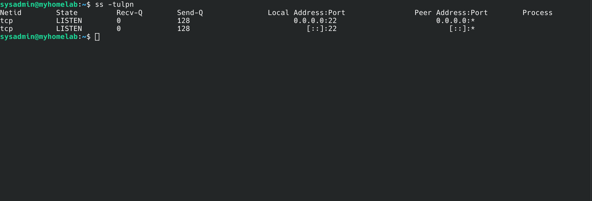

#### Services I removed

| Service | What it does | Why it went |
|---|---|---|
| avahi-daemon | Local network discovery (mDNS) | Not needed on a server, opens UDP ports |
| cups, cups-browsed | Printing | No printers, opened port 631 |
| ModemManager | Mobile modem management | No modem in a VM |
| rtkit-daemon | Realtime scheduling for desktop audio | Desktop component |
| fwupd | Firmware updates | The hypervisor handles firmware |
| udisks2 | Desktop disk mounting | Not needed headless |
| upower | Laptop power management | Not needed in a VM |
| packagekit | Desktop software updater | `unattended-upgrades` already handles updates |

#### Services that remain (and why)

| Service | What it does | Why it stays |
|---|---|---|
| ssh | Remote access | The only way I manage the server |
| fail2ban | Bans IPs after repeated failed logins | Intrusion prevention (Step 6) |
| unattended-upgrades | Installs security updates automatically | Keeps the server patched |
| NetworkManager | Network configuration | Provides the VM's network connection |
| wpa_supplicant | Wi-Fi authentication helper | Pulled in by NetworkManager, harmless in a VM |
| dbus, polkit | System message bus and authorization | Core dependencies of other services |
| systemd-journald | Logging | fail2ban reads SSH logs from the journal |
| systemd-logind | Tracks user sessions | Required for logins |
| systemd-timesyncd | Time synchronization | Accurate time matters for logs and bans |
| systemd-udevd | Device management | Core system function |
| qemu-guest-agent | Host-to-VM communication | Lets libvirt see VM info and shut it down cleanly |
| cron | Scheduled jobs | Used by system maintenance tasks |
| getty@tty1, getty@tty2 | Console login prompts | Emergency access through the virt-manager console |
| user@1001 | Session manager for `sysadmin` | Runs while I'm logged in |


### Step 8: Audit and prove the result
I ran **Lynis** at three points to measure the effect of the work.

| Stage | Hardening index |
|---|---|
| Fresh install (Step 2) | 62 |
| After Steps 3-7 | 67 |
| After 3 Lynis fixes | 68 |


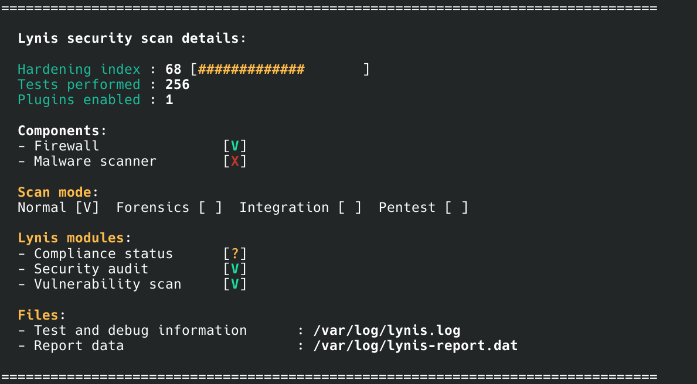

The three fixes I applied from the Lynis suggestions:

```bash
# 1. Legal login banner
echo "Authorized access only. All activity may be monitored and logged." | sudo tee /etc/issue /etc/issue.net

# 2. Password aging for new accounts
sudo sed -i 's/^PASS_MAX_DAYS.*/PASS_MAX_DAYS   90/; s/^PASS_MIN_DAYS.*/PASS_MIN_DAYS   1/' /etc/login.defs

# 3. Process accounting
sudo apt install acct -y
sudo systemctl enable --now acct
```

The full list of Lynis suggestions is in `notes/lynis-findings.txt`.

## What broke and how I fixed it

The short version is below. The full write-up is in [`notes/troubleshooting.md`](notes/troubleshooting.md).

| Problem | Cause | Fix |
|---|---|---|
| `No route to host` / `Connection refused` after a reboot | The VM and libvirt network were not running | `virsh net-start default`, `virsh start`, and `virsh autostart` |
| SSH terminal froze during the fail2ban test | The ban blocked the host's IP, including open sessions | Unbanned from the virt-manager console |
| `ssh ... > file` hung forever | The `sudo` password prompt went into the redirected file | Wrote the file on the VM, then copied it with `scp` |
| `nmap` said "Host seems down" | The firewall silently drops its ping probes | Used `nmap -Pn` |
| Wrong user on login | Two `User` lines in `~/.ssh/config`, and the first one wins | Split into two `Host` entries |

## What I would do next

- Move SSH off port 22 and compare the log noise
- Add `auditd` rules and ship logs to a second machine
- Add a file integrity checker such as AIDE
- Automate the whole build with Ansible so it can be rebuilt in minutes
- Raise the Lynis score further by working through the remaining suggestions

## Security notes

No private keys, passwords, or secrets are stored in this repo. The IP address shown is a private libvirt address that is only reachable from the host machine.
